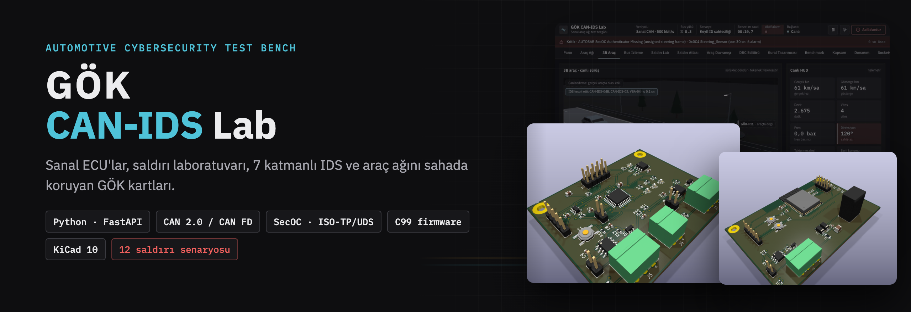
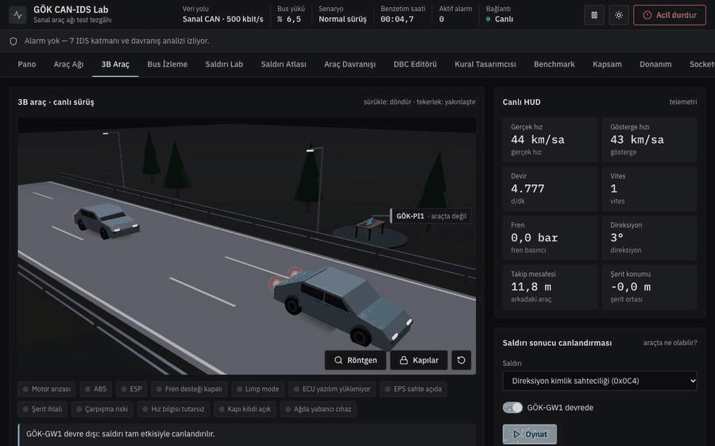
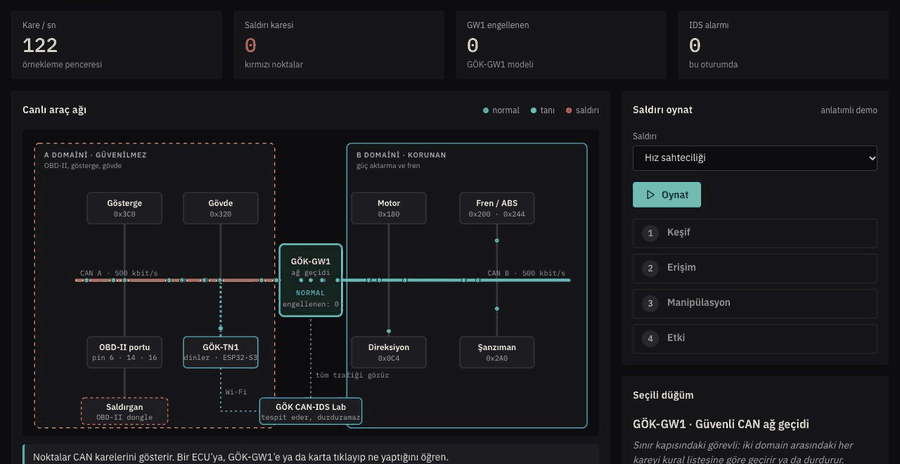
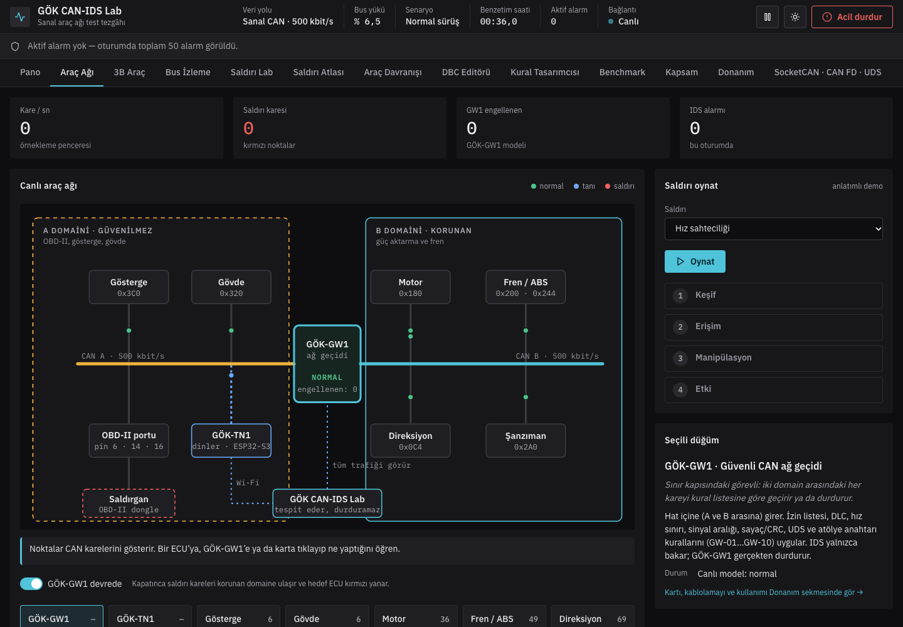
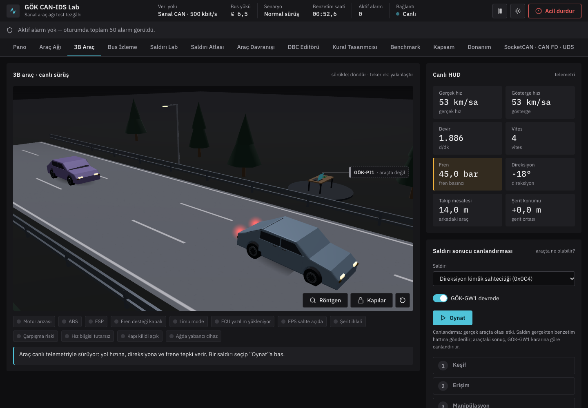
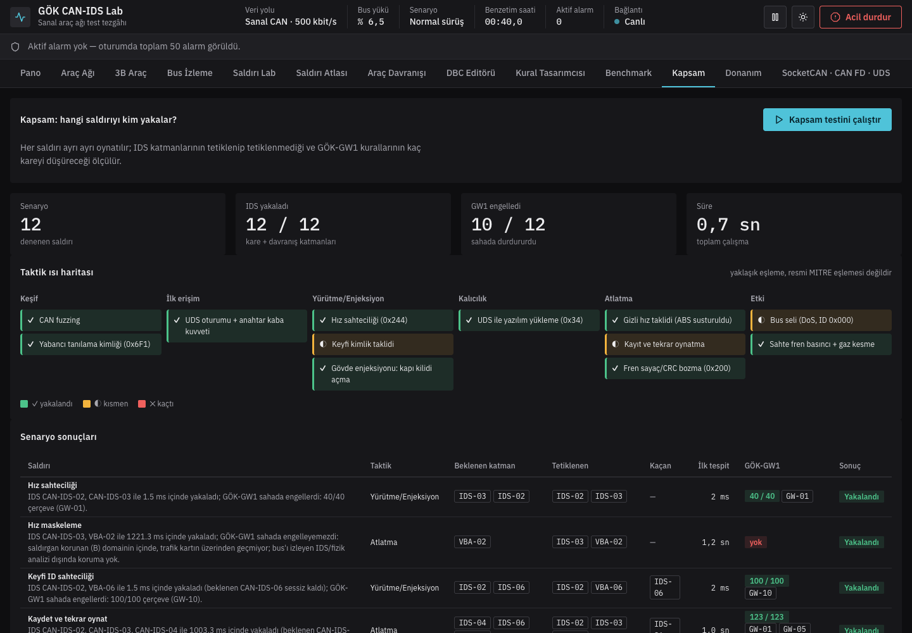
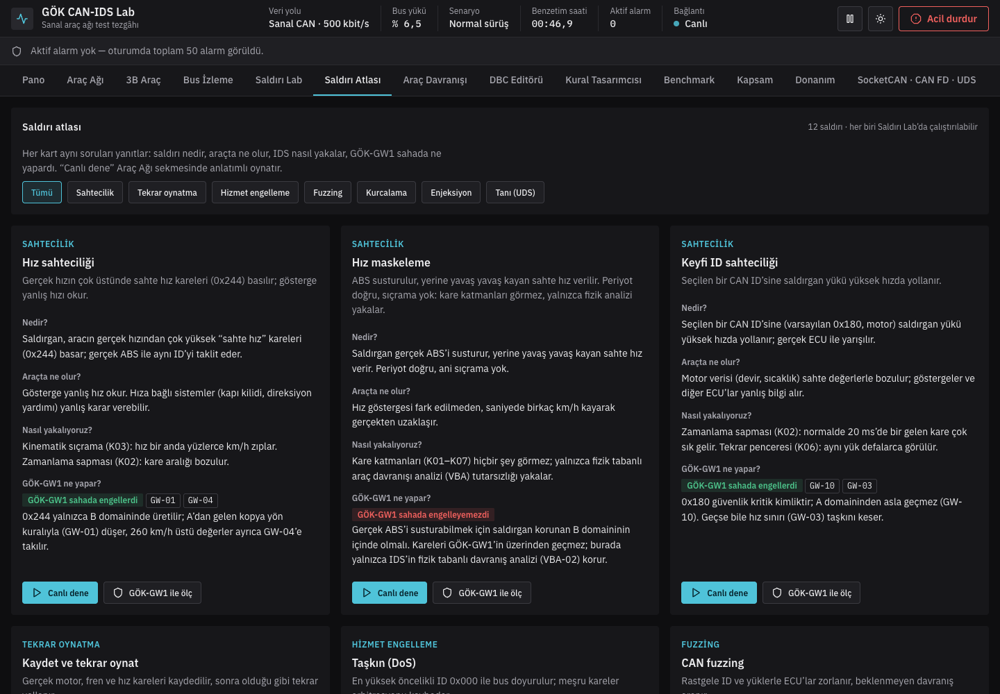
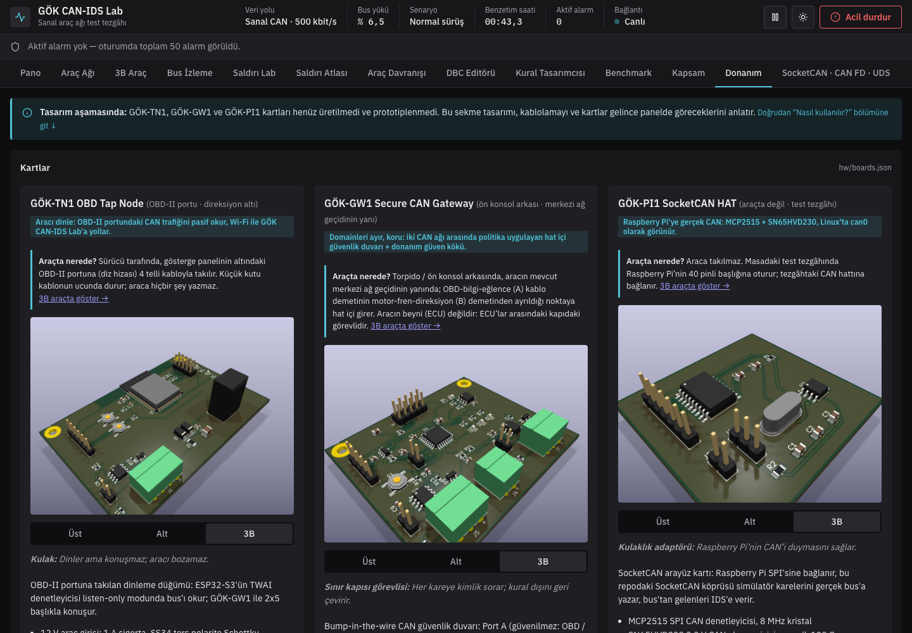
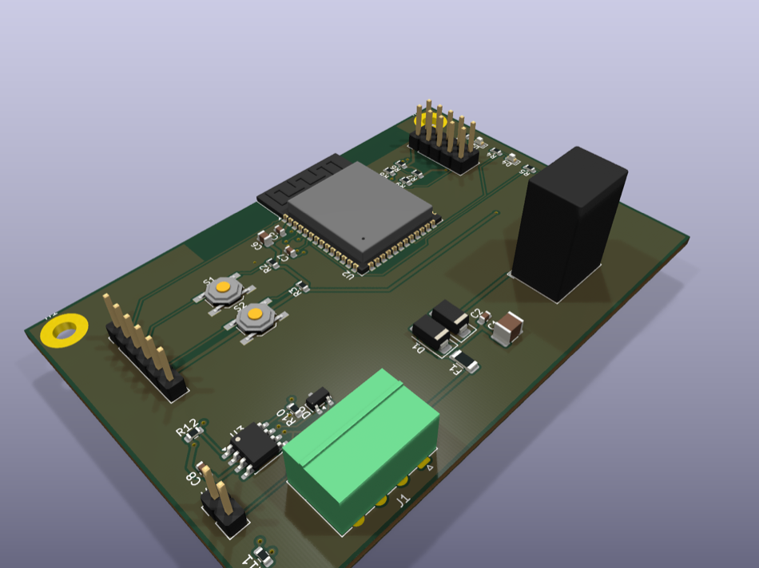
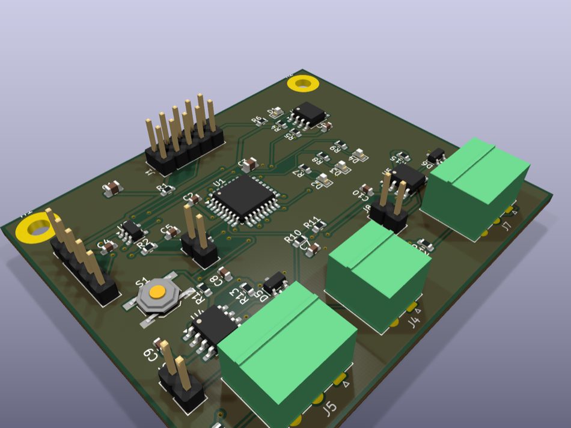

<p align="center">
  
</p>

<p align="center">
  
  
  
  
  
  
  
  <a href="https://www.linkedin.com/in/%C3%B6mer-i%C5%9Fcan-9a64b52b6/"></a>
</p>

**GÖK CAN-IDS Lab**, araç içi CAN ağına yapılan saldırıları gerçek araca ihtiyaç duymadan denemek, tespit etmek ve
durdurmak için kurduğum bir laboratuvar. ECU'lar, araç dinamiği ve CAN veri yolu bellekte simüle ediliyor; üzerine
7 katmanlı bir IDS, araç davranış analizi ve ağı sahada koruyacak GÖK kartlarını (KiCad + C firmware) ekledim.

> **EN** — GÖK CAN-IDS Lab is a virtual automotive cybersecurity test bench: simulated ECUs on an arbitrated CAN bus, a 7-layer IDS with
> vehicle-behaviour analytics, 12 attack scenarios with purple-team coverage, a 3D view of what each attack does to the
> car, and two custom PCBs (an OBD-II listen-only tap and an inline CAN gateway) whose C firmware is compiled from the same DBC.

---

## Demo

**Saldırı araçta ne yapar?** Gateway kapalıyken sahte direksiyon açısı (0x0C4) basılıyor. Araç şeridinden çıkıyor;
IDS imzasız kareyi (SecOC, `CAN-IDS-04B`) ve fiziksel tutarsızlığı (`VBA-04`) 0,2 saniyenin altında yakalıyor.

<p align="center"></p>

**Ağ görünümü.** Sahte fren basıncı saldırısı adım adım oynatılıyor. Kırmızı kareler GÖK-GW1'e takılıyor, IDS alarmı
hedef ECU'nun üzerinde beliriyor.

<p align="center"></p>

## Neler var?

| | Ne yapıyor | Durum |
|---|---|---|
| **CAN-IDS** | 7 kare katmanı (whitelist, zamanlama, kinematik, sayaç/CRC + SecOC, sel, replay, ISO-TP/UDS) ve 6 araç davranışı kuralı | 233 test |
| **Saldırı laboratuvarı** | Spoofing, replay, flooding, fuzzing, UDS kaba kuvvet / reflash, kapı kilidi enjeksiyonu dahil 12 senaryo | canlı panelden çalışır |
| **Purple team** | Her saldırı izole koşulur: beklenen / tetiklenen / kaçan katman, ilk tespit süresi, taktik ısı haritası | IDS **12/12**, GW1 **10/12** |
| **3B araç** | Saldırının araçta olası etkisi (şerit ihlali, ani fren, yanlış gösterge, kilit açılması) ve kartların araçtaki yeri | three.js, internetsiz çalışır |
| **GÖK-TN1** | ESP32-S3 + SN65HVD230; OBD-II portundan yalnız dinler, Wi-Fi ile panele gönderir | KiCad, 0 ERC/DRC hata |
| **GÖK-GW1** | STM32G0B1 (2× FDCAN) + ATECC608A + watchdog + atölye anahtarı + tamper: iki CAN domaini arasında hat içi güvenlik duvarı | KiCad, 0 ERC/DRC hata |
| **GÖK-Guard firmware** | 10 kural, `malloc` yok, politika DBC'den derlenir; Python modeliyle birebir aynı kararı verir | 24 test, 1494 karede parite |
| **GÖK-PI1** | Raspberry Pi için MCP2515 CAN HAT (`can0`), SocketCAN köprüsüyle panele bağlanır | KiCad, 0 ERC/DRC hata |

## Ekranlar

| Araç ağı | 3B araç |
|---|---|
|  |  |
| **Purple team kapsamı** | **Saldırı atlası** |
|  |  |

<p align="center"></p>

## Donanım

<p>
  
  
</p>

```
 OBD-II / bilgi-eğlence (A) ──CAN──► [GÖK-GW1 Secure CAN Gateway] ──CAN──► Motor / fren / direksiyon (B)   ← sahada ENGELLER
                                            │ imzalı olay kaydı (2x5 başlık)
 OBD-II portu ──CAN (listen-only)──► [GÖK-TN1 OBD Tap Node · ESP32-S3] ──Wi-Fi──► GÖK CAN-IDS Lab   ← ağda TESPİT EDER
```

| Kart | Araçta nerede? |
|---|---|
| **GÖK-TN1** | Sürücü tarafı, gösterge panelinin altındaki OBD-II portu (4 telli kablo: pin 6 CANH, 14 CANL, 16 +12 V, 4/5 GND) |
| **GÖK-GW1** | Ön konsol / torpido arkası, merkezi ağ geçidinin yanı; A ve B kablo demetlerinin ayrıldığı nokta |
| **GÖK-PI1** | Araçta değil: masadaki test tezgâhı, Raspberry Pi'nin 40 pinli başlığı |

**Neden iki katman?** IDS bütün bus'ı görür ama durduramaz; kart sahada durdurur ama yalnız iki domain arasındaki trafiği
görür. Gerçek ABS'i susturup yavaşça kayan sahte hız basan saldırgan B domaininin içindedir, kareleri karttan hiç geçmez:
onu yalnız IDS'in fizik tabanlı analizi (`VBA-02`) yakalar. A tarafından gelen sahte fren karesi ise `GW-10` ile durur ve
fren ECU'suna hiç ulaşmaz.

Kurulum adımları (kablolama, sonlandırma jumper'ı, atölye anahtarı, ilk enerji) panelde **Donanım → Nasıl kullanılır?**
bölümünde ve [docs/DONANIM-ENTEGRASYON.md](docs/DONANIM-ENTEGRASYON.md) içinde. Teknik ayrıntılar:
[hardware/README.md](hardware/README.md) · [pin tablosu](hardware/gok-gw1/pinout.md) · [firmware](firmware/gokguard/README.md).

> Kartlar henüz üretilmedi; tasarım KiCad ERC/DRC ve otomatik yönlendirme düzeyinde doğrulandı. Yalnız kendi aracında ya
> da tezgâhta dene, araç hareket halindeyken hiçbir deneme yapma.

## Hızlı başlangıç

Python 3.10+ yeterli.

```bash
git clone https://github.com/sycore35/Automotive-CAN-IDS-Lab.git
cd Automotive-CAN-IDS-Lab
python3 -m venv .venv && source .venv/bin/activate      # Windows: .venv\Scripts\activate
pip install -r requirements.txt
uvicorn src.api:app --host 127.0.0.1 --port 8003
```

Ardından http://127.0.0.1:8003. Hazır başlatıcılar venv'i kendileri kurar: `start.bat` (Windows),
`Start-macOS.command` (çift tık, tarayıcıyı da açar), `./start.sh` (Linux/macOS). Port `CAN_LAB_PORT`, SocketCAN arayüzü
`CAN_LAB_SOCKETCAN` ortam değişkeniyle değişir.

```bash
python -m pytest -q                       # 233 test
make -C firmware/gokguard test            # C firmware testleri (cc + make)
python tools/policy_compiler.py --check   # firmware politikası DBC ile güncel mi?
```

## Ayrıntılar

<details>
<summary><b>IDS katmanları ve gateway kuralları</b></summary>

| Katman | Ne yakalar |
|---|---|
| `CAN-IDS-01` | DBC'de olmayan (ya da yanlış formatta, 11/29 bit) arbitration ID |
| `CAN-IDS-02` | Periyot / zamanlama sapması |
| `CAN-IDS-03` | Fiziksel olarak imkânsız hız değişimi |
| `CAN-IDS-04` | Rolling counter ve CRC-8 (SAE J1850); `04B` SecOC: direksiyon ECU'su 0x0C4'ü veri + tazelik sayacı + 24 bit HMAC-SHA256 ile imzalar, imzasız ya da sayacı atlayan kare alarm verir |
| `CAN-IDS-05` | Bus doygunluğu / flooding |
| `CAN-IDS-06` | Tekrar eden payload (replay) |
| `CAN-IDS-07` | ISO-TP birleştirme ve UDS denetimi (hareket halinde programlama oturumu, SecurityAccess kaba kuvvet) |
| `VBA-01..06` | Hız, devir, vites, fren gibi sinyallerin birbiriyle fiziksel tutarlılığı |

| Gateway kuralı | Ne engeller |
|---|---|
| `GW-01` | A→B izin listesi dışı ID |
| `GW-02` | DLC uyuşmazlığı |
| `GW-03` | ID başına hız sınırı |
| `GW-04` | Sinyal aralık dışı |
| `GW-05` | Sayaç / CRC hatası |
| `GW-06` | Atölye anahtarı yokken UDS isteği |
| `GW-07` | Tehlikeli UDS servisi (0x27, 0x2E, 0x31, 0x34/36/37, 0x11) |
| `GW-08` | Toplam sel |
| `GW-09` | Tamper kilidi (mandallı) |
| `GW-10` | Güvenlik kritik ID'ler (motor, fren, direksiyon) A tarafından asla geçemez |

</details>

<details>
<summary><b>Panel sekmeleri</b></summary>

- **Pano:** hız, devir, fren basıncı, motor sıcaklığı ve direksiyon göstergeleri, canlı alarm akışı, sürücü girdileri
- **Araç Ağı:** iki domainli canlı topoloji, kareler nokta olarak akar; anlatımlı saldırı oynatma
- **3B Araç:** saldırının araçta olası etkisi, GÖK-GW1 aç/kapa, röntgen modunda kartların ve ECU'ların yeri
- **Bus İzleme / Saldırı Lab / Saldırı Atlası:** ham kare izi, 12 senaryo ve parametreleri, her saldırının açıklaması
- **Araç Davranışı / DBC Editörü / Kural Tasarımcısı:** VBA kuralları, mesaj ve sinyal düzenleme (`.dbc` içe/dışa aktarma), kendi kuralını yazıp tek kare üzerinde deneme
- **Benchmark / Kapsam:** her IDS katmanı için TPR, FPR, ilk tespit gecikmesi; purple team raporu
- **Donanım:** kart görselleri, BOM, şematik PDF, Gerber, konnektörler, kurulum kılavuzu, gateway canlı durumu
- **SocketCAN · CAN FD · UDS:** Linux'ta `vcan0`/`can0` köprüsü (iki yönlü), CAN FD kodlayıcı (64 bayt, BRS), UDS günlüğü

Arayüz tamamen Türkçe, grafit siyahı koyu tema varsayılan (açık tema düğmeyle), 375 px genişliğe kadar yatay kaymıyor.

</details>

<details>
<summary><b>Ayarlar (<code>config/config.yaml</code>)</b></summary>

| Anahtar | Varsayılan | Açıklama |
|---|---|---|
| `server.port` | 8003 | Sunucu yalnız `127.0.0.1`'e bağlanır |
| `can.interface_name` | `vcan0` | SocketCAN arayüzü (Raspberry Pi + GÖK-PI1'de `can0`) |
| `ids.enable_detection`, `ids.rules.*` | `true` | Tespiti ya da katmanları (01-06) tek tek açıp kapatır |
| `ids.thresholds.*` | 45 / 80 / 75 / 15 | İvme (km/h/s), zamanlama toleransı (%), bus yükü (%), replay penceresi (ms) |
| `gateway.*` | | GÖK-GW1 politikası; `tools/policy_compiler.py` bunu ve DBC'yi firmware başlığına derler |
| `storage.max_frame_history` | 10000 | SQLite'ta tutulan kare sayısı (alarmlar ve denetim kaydı da budanır) |

Mesaj ve sinyal tanımları `config/can_signals.json` / `.dbc` içinde: `0x180` motor, `0x244` hız, `0x0C4` direksiyon,
`0x200` fren, `0x320` gövde. Bu projeye özgü sentetik bir profil, gerçek bir üretici şeması değil.

</details>

<details>
<summary><b>API</b></summary>

- Telemetri: `GET /api/health`, `/api/telemetry`, `/api/alerts`, `/api/frames`, `/api/bus/trace`, WebSocket `ws://127.0.0.1:8003/ws/telemetry`
- Saldırılar: `POST /api/scenarios/start|stop`, `/api/attacks/run|stop`, `GET /api/attacks/status`
- Kurallar ve DBC: `/api/rules/*`, `/api/dbc/*`, `POST /api/frames/replay-log` (candump, orijinal zamanlamayla)
- Ölçüm: `POST /api/benchmark/run`, `GET|POST /api/coverage[/run]`
- Gateway: `GET /api/guard/state`, `POST /api/guard/mode|events|evaluate`
- SocketCAN ve CAN FD: `/api/socketcan/status|connect|rx`, `/api/canfd/encode|info`

Swagger: `/docs`.

</details>

<details>
<summary><b>Proje yapısı</b></summary>

```
src/
  api.py              FastAPI uygulaması, simülasyon döngüsü, WebSocket
  sim_bus.py          arbitrasyonlu, olay tabanlı CAN bus simülatörü
  ecus.py             sanal ECU'lar (motor, fren/ABS, direksiyon, şanzıman, gösterge, gövde)
  vehicle_dynamics.py araç fiziği
  bench.py            test tezgâhı: ECU'lar + bus + saldırılar
  can_ids.py          IDS katmanları          behavior.py   araç davranış analizi
  isotp_uds.py        ISO-TP / UDS            rules_engine.py kullanıcı kuralları
  attacks.py          saldırı senaryoları     coverage.py   purple team raporu
  gateway_model.py    GÖK-GW1 politikasının Python karşılığı
  dbc_decoder.py, dbc_editor.py, can_frame.py, can_bus.py, canfd.py, socketcan_backend.py
  benchmark.py, storage.py
  ui/                 arayüz (vanilla JS, three.js yerel kopya, hw/ kart çıktıları)
firmware/gokguard/    GÖK-GW1 C99 firmware'i ve testleri
hardware/             kart tanımları, BOM/CPL, ERC/DRC, 3D görseller, pin tablosu
tools/                policy_compiler.py, gen_guard_vectors.py
config/  docs/  tests/
```

</details>

<details>
<summary><b>Güvenlik ve dayanıklılık</b></summary>

- API'yi tarayıcıdan yalnız laboratuvarın kendi sayfası çağırabilir (CORS `127.0.0.1` / `localhost`).
- Tüm sayısal girdiler sınırlı, `NaN` / `Infinity` reddedilir; saldırı parametreleri tip ve aralık olarak doğrulanır.
- Simülasyon döngüsü bir saldırı hata verse bile durmaz; okumayan bir WebSocket istemcisi diğerlerini dondurmaz.
- Kareler ve alarmlar SQLite'a toplu yazılır, tablolar budanır.
- Gateway modelinde tamper kilidi firmware'deki gibi mandallıdır; kapak kapandıktan sonra açıkça kaldırılır.

</details>

## Sınırlar

- Laboratuvar amaçlı. Sunucu yalnız localhost'ta dinler; Linux'ta SocketCAN köprüsü bilerek bağlanmadıkça hiçbir kare gerçek bir ağa gitmez.
- Tespit oranları ve kapsam raporu simülatör verisiyle hesaplanıyor, gerçek araç trafiğiyle doğrulanmadı.
- Kartlar üretilmedi; GW1'in STM32 sürücü katmanı ve ATECC608A sürücüsü iskelet, TN1 firmware'i henüz yazılmadı.
- SocketCAN köprüsü gerçek donanımda denenmedi. DBC desteği formatın bir alt kümesi. Herhangi bir standart ya da sertifikasyon uyumluluğu iddiası yok.

## Geliştirici

**Ömer İşcan** · [LinkedIn](https://www.linkedin.com/in/%C3%B6mer-i%C5%9Fcan-9a64b52b6/) · [GitHub](https://github.com/sycore35)

## Lisans

MIT, bkz. [LICENSE](LICENSE). `src/ui/vendor/three.module.min.js` three.js (MIT) kopyasıdır.
